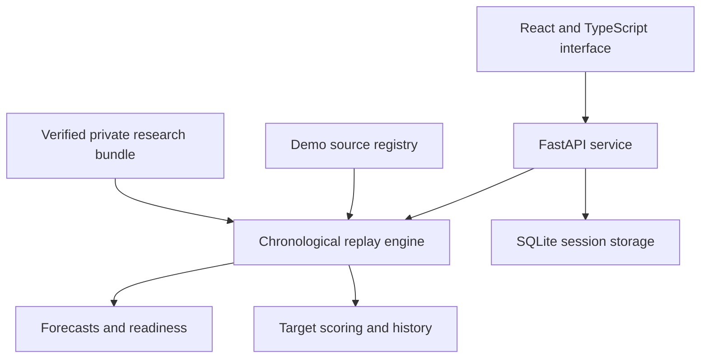

# GlucoTrace

### Patient-Adaptive Glucose Forecasting Research Platform

GlucoTrace is a research prototype for short-term glucose forecasting in adults with Type 2 Diabetes. It compares sensor-only forecasts with forecasts that also use baseline study attributes, and evaluates participant-specific corrections on later observations.

The public demo uses simulated readings. Private retrospective replay uses separately verified Ridge models and research artifacts. GlucoTrace is not clinically validated and does not provide treatment or dosing recommendations.

## Team

**Autom Squad** · **Sri Eshwar College of Engineering**

| Member | Role |
| --- | --- |
| Manish Raghul SJ | Team Lead and Frontend Developer |
| Nethra V D | AI Developer |

## Problem statement

Glucose forecasts are affected by missing readings, incomplete history and differences between individuals. Researchers need to see when a forecast is available, when its outcome can be scored, and whether adaptation improves performance across different glucose ranges.

GlucoTrace provides a replay interface for studying these behaviours using recorded observations and controlled demo scenarios.

## Healthcare use case

Retrospective Type 2 Diabetes forecasting research: compare models, inspect forecast errors, examine missing-input recovery and evaluate exact 30-minute glucose endpoints.

## Features

- Seeded demo scenarios with warm start, playback speed, pause, reset and five-minute steps.
- History readiness and missing-input recovery tracking: 61 minute cells span 60 elapsed minutes.
- Forecasts targeting the exact +30-minute endpoint, with outcomes scored only when the target matures.
- Historical inspection that hides readings and outcomes arriving after the selected cutoff.
- Endpoint flags above 180 and 250 mg/dL.
- Session naming, saved summaries, scenario recreation and five demo export formats.
- Private replay for sensor-only and baseline-plus-sensor models, with adapted and unadapted forecasts. Patient exports are disabled.

## Architecture



The replay engine processes readings in time order, tracks forecast availability and delays scoring until the exact target time. Private replay requires a trusted research bundle, which is not included in the public repository.

## Technical stack

| Layer | Technologies |
| --- | --- |
| Research and numerical processing | Python 3.12, NumPy, pandas, SciPy, scikit-learn, joblib |
| API and storage | FastAPI, Pydantic, Uvicorn, SQLite |
| Frontend | React, TypeScript, Vite, Lucide icons |
| Testing | unittest, HTTPX, Vitest, Playwright Chromium |
| Dependencies | Python requirements files and npm lockfile |

## Models and evaluation

| Model | Description |
| --- | --- |
| Public demo | Persistence carries the current accepted reading forward to +30 minutes. Patient adaptation and calibrated intervals are unavailable. |
| Sensor-only | Ridge regression using 21 trailing sensor features. |
| Baseline plus sensor | Ridge regression using the sensor features plus age, BMI, HbA1c and fasting glucose. |
| Participant adaptation | A fixed median residual correction calculated from an earlier offset phase. |
| Historical benchmark | Ridge and Histogram Gradient Boosting compared with persistence and trailing-linear references. |

Training and evaluation use participant-disjoint splits. Stage 4 uses a 48-hour adaptation phase. Stage 5 uses a 24-hour offset phase followed by 24 hours of interval calibration, then later evaluation with boundary purges. These are separate protocols.

### Findings

Participant adaptation produced a modest overall MAE improvement, with trade-offs across glucose ranges. High-glucose errors and underprediction worsened. Adding baseline attributes did not demonstrate an improvement, so sensor-only remains the default. Observed interval coverage was below the nominal 90% and 95% levels.

### Limitations

The research uses a small retrospective cohort, processed/interpolated readings and overlapping forecast origins. Baseline measurement availability and replay arrival timing remain assumptions. Prospective performance and clinical benefit have not been established.

Threshold flags describe the exact +30-minute endpoint; they are not episode predictions or probabilities. GlucoTrace does not connect to a live sensor or recommend care.

## Installation

From a fresh checkout in Windows PowerShell:

```powershell
git clone https://github.com/manishrahul1705/GlucoTrace.git
cd GlucoTrace
py -3.12 -m venv .venv
$python = '.\.venv\Scripts\python.exe'
& $python -m pip install -r requirements-stage6.txt
npm.cmd ci --prefix frontend
& $python scripts/start_stage6.py
```

Open [http://127.0.0.1:15173/](http://127.0.0.1:15173/). The default is demo-only and requires no patient data.

For the recorded demonstration, use **Warm start**, seed **1705** and duration **720 simulated minutes**. The interface identifies the source as **“Demo data — simulated readings.”**

If the default Vite configuration loader encounters an environment access error:

```powershell
& $python scripts/start_stage6.py --config-loader runner
```

## Tests

```powershell
$env:PYTHONPATH = 'src'
& $python -m unittest discover -s tests -p 'test_*.py' -v
npm.cmd test --prefix frontend
npm.cmd run typecheck --prefix frontend
npm.cmd run build --prefix frontend
& $python scripts/verify_portable_package.py --mode source
```

## Demo video

[Watch the GlucoTrace demonstration — 18:02](https://youtu.be/5mwbA8xUERc)

## Presentation

[View the project presentation](https://drive.google.com/file/d/1AzcyUzdZRmnOqMctWw83UJWSqH3GKpNr/view?usp=sharing)

## License

The independently authored project code is licensed under the [MIT License](LICENSE).

Dataset, trained-model and third-party terms are separate from the code license. CGMacros data must be obtained from its publisher under the applicable terms. Private datasets, fitted models, calibration artifacts and authorization records are not included in this repository.
