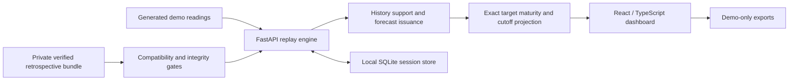

# GlucoTrace

**Patient-Adaptive Glucose Forecasting Research Platform**

GlucoTrace is a research prototype for retrospective continuous glucose monitoring (CGM) forecasting in adults with Type 2 Diabetes. It asks whether baseline study attributes add value to short-term sensor dynamics, and whether a fixed within-participant correction improves forecasts on later observations.

The public demo uses **generated readings and persistence**. Private retrospective replay uses separately verified, patient-trained Ridge models and restricted artifacts. Neither mode is clinically validated or provides treatment or dosing recommendations.

## Team and institution

**Autom Squad · Sri Eshwar College of Engineering**

| Member | Role |
| --- | --- |
| Manish Raghul SJ | Team Lead and Frontend Developer |
| Nethra V D | AI Developer |

No incubator affiliation is claimed.

## Problem and healthcare research use case

Short-horizon glucose forecasts can be sensitive to noise, missing history and differences between individuals. A useful research interface must expose when forecasts are supported, when outcomes are still pending, and whether a correction helps some glucose ranges while harming others.

GlucoTrace supports retrospective comparison and inspection of these behaviours. It does not connect to a live sensor, predict clinical episodes, or recommend care. Baseline attributes are **age, BMI, HbA1c and fasting glucose**, not longitudinal EHR. Their actual availability before evaluation is an unresolved assumption.

## Implemented features

- Seeded demo scenarios, warm starts, playback speed, pause, reset and five-minute steps.
- History support and suppression/recovery tracking: **61 minute cells span 60 elapsed minutes**.
- Immutable forecast origin/target records, exact **+30-minute** target scoring, and historical cutoffs that hide later information.
- Threshold flags for the exact endpoint above 180 or 250 mg/dL; these are endpoint decisions, **not episode/onset predictions or probabilities**.
- Local session naming, retained summaries and scenario recreation; five demo export formats. Patient exports are disabled.
- Independent experiment verification and genuine HTTP/Chromium acceptance tools. Private replay requires a complete trusted bundle; source checkout alone does not contain it.

See [Scenario Lab contracts](docs/stage6/SCENARIO_LAB.md), [new-experiment workflow](docs/stage6/NEW_EXPERIMENT.md) and [fusion/endpoint scope](docs/stage6/FUSION_AND_ENDPOINTS.md).

## Architecture overview



The source registry keeps demo and private inputs distinct. Replay processes chronological arrivals; outcome scoring waits for exact target maturity. The [technical architecture](docs/stage6/ARCHITECTURE.md) provides implementation detail. This Markdown diagram **does not satisfy the requested PDF/PPT architecture deliverable**; that file remains independently unconfirmed.

## Technical stack

| Layer | Technologies |
| --- | --- |
| Research and numerical processing | Python 3.12, NumPy, pandas, SciPy, scikit-learn, joblib |
| API and persistence | FastAPI, Pydantic, Uvicorn, SQLite |
| Interface | React, TypeScript, Vite, Lucide icons |
| Verification | unittest, HTTPX, Vitest, Playwright Chromium; explicit source-package manifest |
| Dependencies | Versioned Python requirements and npm lockfile |

## Models and evaluation

| Context | Model and scope |
| --- | --- |
| Public demo | Authored generated readings; persistence carries the current accepted value to +30 minutes. No patient adaptation or calibrated intervals. |
| Private sensor-only replay | Ridge regression using 21 trailing sensor features; trained/scaled on permitted training partitions. |
| Private baseline-plus-sensor replay | Ridge with the same sensor features plus age, BMI, HbA1c and fasting glucose. Sensor-only remains the default. |
| Adapted versus unadapted | Adapted forecasts add a fixed participant-specific median residual correction from an earlier offset phase. Unadapted forecasts retain the model output. This is not continuous retraining. |
| Historical benchmark | Ridge and Histogram Gradient Boosting, with persistence and trailing-linear references; participant-disjoint outer evaluation and grouped inner selection. |

Stage 4 uses its documented 48-hour adaptation phase. Stage 5 separately uses a 24-hour offset phase and a further 24-hour interval-calibration phase, followed by later evaluation and boundary purges. These protocols and results must not be conflated. Nominal 90%/95% intervals express requested levels; **observed coverage is a measured outcome, not a guarantee**.

Protocols: [evaluation](docs/stage2/evaluation_protocol.md), [features](docs/stage2/feature_specification.csv), [implemented uncertainty](docs/stage5/IMPLEMENTED_PROTOCOL.md). Historical records and internal `glucotwin` package names remain unchanged.

## Verified findings and limitations

Existing documented findings show a modest overall MAE improvement from adaptation, alongside slice trade-offs: high-glucose errors and underprediction worsened. Baseline fusion did not demonstrate improvement; sensor-only remains the default. Observed interval coverage was below nominal. These are cohort- and protocol-specific retrospective findings, not evidence of clinical benefit. No new private numerical outputs are published here; see the existing [historical project record](PROJECT_STATUS.md).

Important limitations include processed/interpolated source data, unknown baseline measurement availability, assumed replay arrival timing, a small evaluated cohort and overlapping forecast origins. Live causal equivalence, prospective performance and clinical validation are not established. No treatment, dosing or clinical alert recommendation is provided.

The relevant Stage B checkpoint recorded **207 backend tests** and **33 frontend tests**, plus typecheck/build success. Those are reused revision-specific results, not fresh test runs for this README edit. Later demo checks, recording verification and source-package integrity checks are separate evidence, not updated suite totals. Technical implementation/rehearsal is complete within these documented limitations; competition-use clarification and actual submission remain pending/unconfirmed.

## Installation and launch

Windows / PowerShell, from a fresh checkout:

```powershell
git clone https://github.com/manishrahul1705/GlucoTrace.git
cd GlucoTrace
py -3.12 -m venv .venv
$python = '.\.venv\Scripts\python.exe'
& $python -m pip install -r requirements-stage6.txt
npm.cmd ci --prefix frontend
& $python scripts/start_stage6.py
```

Open http://127.0.0.1:15173/. The default is demo-only; no patient data is required. Select **Warm start**, seed **1705**, duration **720 simulated minutes**. Keep **“Demo data — simulated readings”** visible. Simulated dataset duration is independent of video duration.

Use distinct free ports if necessary. The documented `--config-loader runner` workaround is available when the default Vite loader encounters restricted-environment access errors. See [setup and verification](docs/stage6/README.md) for interpreter selection, POSIX equivalents and isolated runtime guidance. Do not overwrite an existing environment or reuse a private library for a public demonstration.

```powershell
$env:PYTHONPATH = 'src'
& $python -m unittest discover -s tests -p 'test_*.py' -v
npm.cmd test --prefix frontend
npm.cmd run typecheck --prefix frontend
npm.cmd run build --prefix frontend
& $python scripts/verify_portable_package.py --mode source
```

Dataset acquisition and research execution are separate from this demo quickstart. Review [data-use restrictions](docs/DATA_USE_ACQUISITION_REVIEW.md) and [licensing status](docs/stage2/licensing_status.md) before obtaining or processing data. Do not generate substitutes to bypass private replay compatibility gates.

## Demo Video

[Watch the GlucoTrace demonstration on YouTube](https://youtu.be/5mwbA8xUERc)

## Presentation

[View the GlucoTrace presentation](https://drive.google.com/file/d/1AzcyUzdZRmnOqMctWw83UJWSqH3GKpNr/view?usp=sharing)

## Demo, presentation and submission checklist

The [uploaded demo video](https://youtu.be/5mwbA8xUERc) is **18:02**, within the required 15–20 minutes, as confirmed by anonymous YouTube metadata on 2026-10-20. The local silent walkthrough was previously recorded as 18:01. **Silent video; narration supplied separately.** The timestamped script is prepared; narration is in preparation. The large local video is not stored in Git. The older [recording checklist](docs/stage6/DEMO_RECORDING.md) describes the superseded 30-minute plan; the completed take uses the revised 18-minute scope.

The supplied [project/outcomes presentation](https://drive.google.com/file/d/1AzcyUzdZRmnOqMctWw83UJWSqH3GKpNr/view?usp=sharing) was identified by the team as `GlucoTrace_Digital_Twin_Challenge_2026.pdf`. The maintainer manually verified on **20 October 2026** that the presentation opens without authentication or a permission request. This is a maintainer-verified access result; file contents and architecture compliance remain **unverified**. Its repository addition remains pending.

| # | Organizer requirement | Current status |
| --- | --- | --- |
| 1 | Team details | Autom Squad; two confirmed members and roles listed above. |
| 2 | College/incubator information | Sri Eshwar College of Engineering; no incubator affiliation claimed. |
| 3 | Project title | GlucoTrace — Patient-Adaptive Glucose Forecasting Research Platform. |
| 4 | Problem statement | Described above, including missing-input and evaluation-time boundaries. |
| 5 | Healthcare use case | Retrospective Type 2 Diabetes forecasting research; no clinical recommendations. |
| 6 | Technical stack | Listed above; dependencies versioned in requirements/lockfile. |
| 7 | AI/ML model/framework details | Persistence demo, private Ridge variants, historical benchmark and evaluation distinctions documented above. |
| 8 | Unlisted YouTube demo, 15–20 minutes | [Demo video](https://youtu.be/5mwbA8xUERc): anonymous YouTube metadata confirms **18:02** (1,082 seconds) and playable status on 2026-10-20. Unlisted visibility setting not independently verified; script prepared, narration in preparation. |
| 9 | Open-source license | Code MIT; separate dataset and third-party terms apply. |
| 10 | Architecture diagram in PDF/PPT | **In preparation**; file not independently confirmed. Markdown architecture does not complete this requirement. |
| 11 | Project/outcomes presentation in PDF/PPT | [Presentation link](https://drive.google.com/file/d/1AzcyUzdZRmnOqMctWw83UJWSqH3GKpNr/view?usp=sharing) opens without authentication or a permission request, **manually verified by the maintainer on 20 October 2026**. Content review and repository addition remain pending. |
| 12 | Public access without additional permissions | Repository: [GlucoTrace](https://github.com/manishrahul1705/GlucoTrace). Video page and playable metadata accessible anonymously on 2026-10-20. Presentation opens without authentication or a permission request, **manually verified by the maintainer on 20 October 2026**. Repository anonymous access not checked in this update. |

All twelve requirements are addressed as information or explicit gaps, not all completed deliverables. Competition-use clarification is pending, and actual submission is unconfirmed. Public source availability does not clear restricted-data publication or establish submission readiness.

## Code, data and third-party licensing

The tracked [LICENSE](LICENSE) grants MIT terms for independently authored code, tests, scripts and configurations; its historical copyright naming is preserved. The code license **does not relicense patient data, trained models, calibration files or other derived artifacts**. Dependency and other third-party licenses remain separate.

CGMacros dataset terms and cross-deposit licensing questions are documented in [licensing and permissions](docs/stage1/licensing_and_permissions.md) and the [permissions tracker](docs/licensing_and_permissions_tracker.md). Obtain data from its publisher under applicable terms. Private datasets, fitted models, authorization records and patient screenshots are not submission assets and must remain outside Git and source packages.
