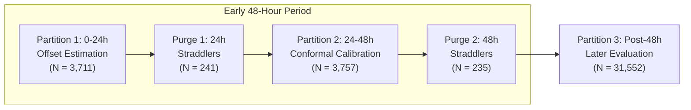

# Historical proposal and implemented protocol pointer

Stage 5 was subsequently authorized and implemented in the current task.
The frozen implemented authority is `configs/stage5_protocol.json`, documented in
[IMPLEMENTED_PROTOCOL.md](IMPLEMENTED_PROTOCOL.md). Its pre-evaluation hash is in
`reports/stage5/protocol_freeze.json`; execution and verification evidence is in
`reports/stage5/`. The proposal below is preserved as history, including its earlier
not-executed status and prior authorization boundary. The implemented specification
resolves the displayed purge-interval ambiguity using full support predicates,
rejects an entire calibration set on invalid scores, and defers interval scores.
Both explicit sensor-only references remain; no default was selected.

---

# Stage 5 Proposed Protocol: Conformal Uncertainty Estimation & Failure Handling

**Document Identifier**: `docs/stage5/PROPOSED_UNCERTAINTY_PROTOCOL.md`  
**Status**: PROPOSED CANDIDATE SPECIFICATION — NOT EXECUTED  
**Stage**: Stage 5 (Uncertainty and Failure Handling)  
**Population**: 14 Type 2 Diabetes Participants (CGMacros PhysioNet release)  
**Target Variable**: 30-Minute Ahead Glucose (\(g(t+30)\) in mg/dL)  

---

## 1. Scientific Scope & Foundational Caveats

### Exploratory Status on Previously Examined Cohort
Stage 5 designs uncertainty intervals and failure-handling procedures for retrospective continuous glucose forecasting. 
- **Cohort Re-examination**: The 14 T2D participants evaluated here were previously examined in Stage 3 and Stage 4. Stage 5 is an exploratory retrospective investigation on this known cohort; the later evaluation period is strictly held out from parameter fitting and quantile calibration, but it is not an entirely unseen independent clinical cohort.
- **Processed Release vs Native Hardware**: The underlying data reflects released Dexcom G6 data with upstream interpolation, factory calibration, and undocumented sensor-level filtering. Causal live equivalence is **NOT ESTABLISHED**.
- **No Exchangeability Guarantee**: Standard split-conformal finite-sample coverage guarantees rely fundamentally on exchangeability (or i.i.d. sampling) between calibration and test observations. Continuous glucose time-series observations exhibit strong temporal autocorrelation, non-stationary circadian rhythms, and overlapping forecast horizons (\(H=60\text{ min}\) history, \(h=30\text{ min}\) lead time). While separating calibration from evaluation prevents circular data reuse, **it does not establish theoretical exchangeability**.
- **Terminology Rule**: Coverage metrics must be described strictly as **“nominal coverage”** (e.g. \(1 - \alpha = 0.90\)) and **“measured held-out empirical coverage”**. Coverage bounds must never be described as "guaranteed," "distribution-free finite-sample guarantees," or "clinically certified."
- **Medical Boundary**: Conformal intervals provide predictive uncertainty bands around regression forecasts. They must never be used to derive event-crossing probabilities, clinical risk alerts, insulin titration thresholds, or autonomous patient alerts.

---

## 2. Partition Architecture: Separate Offset Fitting & Interval Calibration

To eliminate circular calibration leakage, Stage 5 does not reuse the same residuals for both median offset fitting and conformal interval calibration. The initial 48-hour observation window is strictly partitioned into two 24-hour periods, followed by the post-48-hour evaluation period.



### Partition Boundary Definitions
For each participant:
- Anchor \(t_0\): First valid Dexcom timestamp.
- Intermediate Boundary \(t_{\text{mid}} = t_0 + 24\text{ elapsed hours}\).
- Terminal Calibration Boundary \(t_{\text{boundary}} = t_0 + 48\text{ elapsed hours}\).
- Missing time remains elapsed clock time; gaps are never compressed into usable hours.

1. **Partition 1: Offset Estimation Window \([t_0, t_{\text{mid}})\)**:
   - Condition: `history_start >= t0` and `target_time < t_mid`.
   - Used exclusively to estimate the patient-specific scalar median residual offset:
     $$\Delta_{\text{offset}} = \text{median}(\{y_i - \hat{y}_{\text{base}, i} : i \in \text{Partition 1}\})$$
2. **Purged Boundary 1 \([t_{\text{mid}} - 60\text{m}, t_{\text{mid}} + 30\text{m}]\)**:
   - Condition: `history_start < t_mid <= target_time`.
   - Any origin whose required trailing 60-minute history or 30-minute target interval straddles the 24-hour boundary is purged to prevent temporal leakage between offset estimation and conformal calibration.
3. **Partition 2: Conformal Interval Calibration Window \([t_{\text{mid}}, t_{\text{boundary}})\)**:
   - Condition: `history_start >= t_mid` and `target_time < t_boundary`.
   - Adapted predictions are formed using the frozen offset from Partition 1:
     $$\hat{y}_{\text{adapted}, k} = \hat{y}_{\text{base}, k} + \Delta_{\text{offset}} \quad \text{for } k \in \text{Partition 2}$$
   - Nonconformity scores \(s_k\) are computed from the adapted predictions:
     $$s_k = |y_k - \hat{y}_{\text{adapted}, k}|$$
4. **Purged Boundary 2 \([t_{\text{boundary}} - 60\text{m}, t_{\text{boundary}} + 30\text{m}]\)**:
   - Condition: `history_start < t_boundary <= target_time`.
   - Boundary straddlers purged identically to Stage 4.
5. **Partition 3: Later Evaluation Window \([t_{\text{boundary}}, \text{end})\)**:
   - Condition: `history_start >= t_boundary`.
   - Exactly identical to Stage 4 later evaluation origins (\(N = 31,552\)).
   - Evaluates adapted point predictions and conformal prediction intervals simultaneously.

### Verified Timestamp-Based Partition Counts (Cohort Totals)
| Partition | Purpose | Origin Count | Per-Participant Range | Adequacy Status |
|---|---|:---:|:---:|:---:|
| **Partition 1** | Offset Estimation (0–24h) | 3,711 | 255 – 270 | All 14 pass (\(\ge 100\)) |
| **Purged Boundary 1** | 24h Straddler Purge | 241 | 7 – 18 | Fully isolated |
| **Partition 2** | Conformal Calibration (24–48h) | 3,757 | 258 – 270 | All 14 pass (\(\ge 100\)) |
| **Purged Boundary 2** | 48h Straddler Purge | 235 | 9 – 18 | Fully isolated |
| **Partition 3** | Later Evaluation (Post-48h) | 31,552 | 2,218 – 2,261 | All 14 pass (\(\ge 100\)) |
| **Total Origins** | Whole-Cohort Grid | **39,496** | — | **14 / 14 Eligible** |

---

## 3. Conformal Prediction Interval Specification

### Nonconformity Score & Method Hierarchy
1. **Initial Baseline Method**: Fixed-width absolute residual conformal prediction:
   $$s_k = |y_k - \hat{y}_{\text{adapted}, k}|$$
   - Half-width \(\hat{q}_{1-\alpha}\) is a single scalar per participant.
   - Defer locally-scaled intervals (e.g. scaled by `glucose_std_30m`) until the fixed-width baseline has been verified.
2. **Nominal Coverage Levels**:
   - \(1 - \alpha = 0.90\) (90% nominal coverage)
   - \(1 - \alpha = 0.95\) (95% nominal coverage)

### Exact Finite-Sample Quantile Rule & Indexing
This is a proposed specification only, not a Stage 5 implementation.
For n finite calibration scores and 0 < alpha < 1:

```python
k = ceil((n + 1) * (1 - alpha))
if n < 100 or k > n:
    return UNAVAILABLE_INSUFFICIENT_CALIBRATION
q = sorted_scores[k - 1]  # kth smallest; zero-based array indexing
```

Do not use an interpolated NumPy percentile or quantile. If k > n, do not
substitute the largest finite score. No interval is available for that level.
Use closed intervals [prediction - q, prediction + q]; targets exactly equal
to either endpoint count as covered. Tied calibration scores remain in the
sorted array. No physiological clipping is applied.

### Adequacy & Fallback Conditions
- **Minimum Calibration Sample**: A participant must have \(n \ge 100\) valid calibration origins in Partition 2. With \(n \approx 260\), \((n+1)(0.90) \approx 235\) and \((n+1)(0.95) \approx 248\), which are well within the calibration sample size for all 14 participants.
- **Fallback / Unavailable**: If \(n < 100\) or k > n, prediction intervals are marked `UNAVAILABLE_INSUFFICIENT_CALIBRATION`.

---

## 4. Evaluation Metrics for Stage 5

1. **Empirical Coverage**:
   - Indicator: \(\mathbb{I}(y_j \in \mathcal{C}_{1-\alpha}(x_j))\)
   - Per-participant empirical coverage: \(C_p = \frac{1}{N_p} \sum_{j=1}^{N_p} \mathbb{I}(y_j \in \mathcal{C}(x_j))\)
   - Primary metric: Equal-person empirical coverage \(\bar{C} = \frac{1}{14} \sum_{p=1}^{14} C_p\)
   - Secondary metric: Window-weighted empirical coverage \(\tilde{C} = \frac{1}{N_{\text{total}}} \sum_{j} \mathbb{I}(y_j \in \mathcal{C}(x_j))\)
2. **Interval Efficiency (Width)**:
   - Equal-person mean interval width: \(2 \cdot \hat{q}_{1-\alpha}\) (mg/dL)
   - Inter-participant width variation (min, median, max width)
3. **Winkler Score (Interval Score)**:
   For interval \([L, U]\) with width \(W = U - L\) and nominal level \(\alpha\):
   $$\text{Score}(L, U, y) = W + \frac{2}{\alpha}(L - y)\mathbb{I}(y < L) + \frac{2}{\alpha}(y - U)\mathbb{I}(y > U)$$
   Penalizes wide intervals while heavily penalizing coverage failures.

---

## 5. Honest Missing-Data & Failure Handling

### Nature of Missingness in Processed CGMacros Release
The dataset does not provide raw Bluetooth packets, radio-frequency signal strengths, transmitter battery alerts, or hardware reconnection flags.
- **Released Gaps**: Gaps in the published grid correspond to times where Dexcom sensor values were invalid or omitted after upstream processing.
- **True Dropout Unidentifiability**: Upstream interpolation may have masked brief 5-to-15 minute dropouts. Observed contiguous segments cannot be assumed to represent raw sensor arrivals.

### Synthetic Dropout Stress-Testing Protocol
To evaluate failure modes honestly without fabricating hardware logs, Stage 5 implements **deterministic synthetic dropout stress tests**:
1. **Synthetic Gap Injection**:
   - Inject structured dropouts of duration 15 min (3 steps), 30 min (6 steps), 60 min (12 steps), and 120 min (24 steps) at pre-specified evaluation origin times.
2. **Operational Failure Rules**:
   - **No Backward Filling / Interpolation**: Never reconstruct missing trailing history via future values or linear interpolation across gaps.
   - **History Completeness Gate**: Generating a forecast requires full availability across the declared trailing 60-minute window (\(t-60\) to \(t\)). If any required lag is absent, forecast state must be `UNAVAILABLE_INCOMPLETE_HISTORY`.
   - **Staleness Threshold**: If the most recent valid sensor observation is \(> 10\text{ minutes}\) old relative to replay timestamp \(t\), emit `UNAVAILABLE_STALE_SIGNAL`.
   - **Resumption Gate**: Following a gap, forecasting resumes only after 60 continuous minutes of valid readings have accumulated to reconstruct the feature vector.
   - **Structured Failure Codes**:
     - `OK`: Forecast generated with complete history.
     - `UNAVAILABLE_STALE_SENSOR`: Last reading older than staleness threshold.
     - `UNAVAILABLE_MISSING_HISTORY`: History window contains missing cells.
     - `UNAVAILABLE_CALIBRATION_DEPLETED`: Insufficient valid calibration data for interval width.

---

## 6. Pre-Registration & Anti-Leakage Constraints

1. **No Tuning Against Later Outcomes**: The 24h/24h split is predeclared based strictly on timestamp feasibility (\(3,711\) and \(3,757\) origins). Boundaries must not be adjusted after inspecting later coverage or interval widths.
2. **Frozen Base Point Forecasts**: Stage 5 would retain the frozen LOPO Ridge base predictors. The proposed 24-hour offset differs from Stage 4's 48-hour offset: its adapted predictions must be recomputed from Partition 1 and freshly evaluated. Stage 4 adapted outcomes cannot be reused as results for this new model.
3. **Independent Reproducibility**: Stage 5 will include an independent verifier `scripts/verify_stage5.py` verifying interval coverage and Winkler scores directly from residuals.

## Final correction constraints (2026-10-15)

Excluded from model fitting and interval calibration; outcomes from this cohort have previously been examined, so this analysis remains exploratory.

Keep both unadapted sensor-only and newly 24-hour-adapted sensor-only references,
with separate Partition 2 absolute residual scores and quantiles for each.
Require at least 100 finite offset-fitting origins for the adapted reference and
at least 100 finite interval-calibration scores per participant, reference, and
nominal level; also require k <= n. Invalid/non-finite scores must be excluded
and counted explicitly; no borrowing from evaluation or offset-fitting scores.
These proposed adequacy rules do not establish exchangeability for dependent
observations. Nominal 90%/95% coverage is a requested level; measured empirical
coverage is an outcome, not a guarantee.

Stage 4 adaptation increased >180 mg/dL slice MAE by 0.570931 mg/dL and increased
underprediction (mean signed error -9.878717 to -11.097888 mg/dL). Do not choose
a default from overall MAE alone, switch models by observed target, or tune a
correction against these evaluation outcomes. No Stage 5 execution is authorized
by this correction. The 24-hour model requires fresh evaluation.
